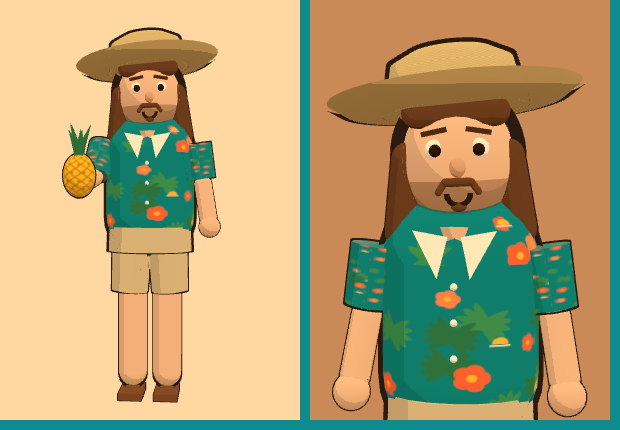

# Pineapple Barista (рабочее название)

Time-management игра про кофейню: заказы, посетители с терпением, мини-игры приготовления, прокачка от пляжного киоска до собственной обжарочной.

**Играть:** https://skizziik.github.io/test_nb1/

## Структура

| Путь | Что там |
|---|---|
| `docs/GDD.md` | Геймдизайн-документ: механики, посетители, прогрессия, MVP |
| `docs/ECONOMY.md` | Формулы экономики, таблицы, результаты симуляции баланса |
| `docs/CHARACTER_3D_PIPELINE.md` | Как сделать 3D героя из фото |
| `data/balance.json` | Все цифры баланса, единый источник для игры и симулятора |
| `tools/economy_sim/` | Monte Carlo симулятор экономики с ботами-игроками |
| `docs/balance/` | Отчёт и графики последнего прогона |
| `web/` | Браузерная игра: HTML, CSS, JS (ES-модули, без фреймворков) |
| `src/hero3d.js` | Исходник 3D героя: модель из примитивов, toon-шейдинг, анимации |
| `src/world.js` | 3D мир: пляж, шэк, море, пальмы, герой за стойкой, гости в очереди, темы 4 локаций |
| `web/js/world.bundle.js` | Собранный 3D мир + three.js (коммитится, чтобы Pages работал без сборки) |
| `assets/hero.glb` | 3D модель героя для Blender / Unity / Unreal (54 меша, иерархия частей) |
| `tools/hero_export/` | Экспорт героя в GLB через headless Chromium |
| `tests/` | Тест движка: бот по подсказкам коуча играет 45 дней и проходит все 4 локации |
| `.github/workflows/pages.yml` | Тест + автодеплой на GitHub Pages при пуше в `main` |

## Запустить локально

```bash
python -m http.server 8000
# открыть http://localhost:8000/web/
# ускорить время для тестов: http://localhost:8000/web/?speed=4
```

Игра читает `data/balance.json`, поэтому открывать через http, а не двойным кликом по файлу.

## Симулятор баланса

```bash
pip install matplotlib
python tools/economy_sim/sim.py --days 60 --seeds 40 --plots docs/balance
```

## Пересобрать 3D героя

```bash
npm install
npm run build        # web/js/world.bundle.js
npm run export-glb   # assets/hero.glb (нужен python + playwright)
```



## Статус

v2.0: игра целиком в 3D. Смена идёт в живой сцене: шэк на пляже, море с волнами, пальмы, герой за стойкой работает на станциях, гости с разной внешностью подходят в очередь, ждут и уходят со стаканом. У каждой из 4 локаций своя сцена (пляж, променад с колесом обозрения, старый город с домами и фонтаном, вечерняя обжарочная). Если положить модель героя из фото в `web/assets/hero_photo.glb`, игра подхватит её вместо toon-модели.

### Раньше

v1.0: полная версия.

- 4 локации с переездом: Beach Shack, Boardwalk Cafe, Old Town Coffee House, Pineapple Roastery, у каждой своя сцена.
- 12 напитков, 16 станций (помол, экстракция, молоко, матча, пуровер как мини-игры), модификаторы размер / сироп / доп. шот.
- 5 типов гостей плюс критик, события дня, помощник бариста, который сам делает простые напитки.
- 3D герой в toon-стиле (соломенная шляпа, длинные волосы, усы, гавайка, ананас), реагирует на игру: работает, радуется, грустит, смотрит на гостя.
- Коуч для первых дней: подсвечивает следующую кнопку. Отключается кнопкой 💡.
- Синтезированные звуки без файлов, выключаются кнопкой 🔊.
- Сохранение в браузере, адаптив под мобилки.
